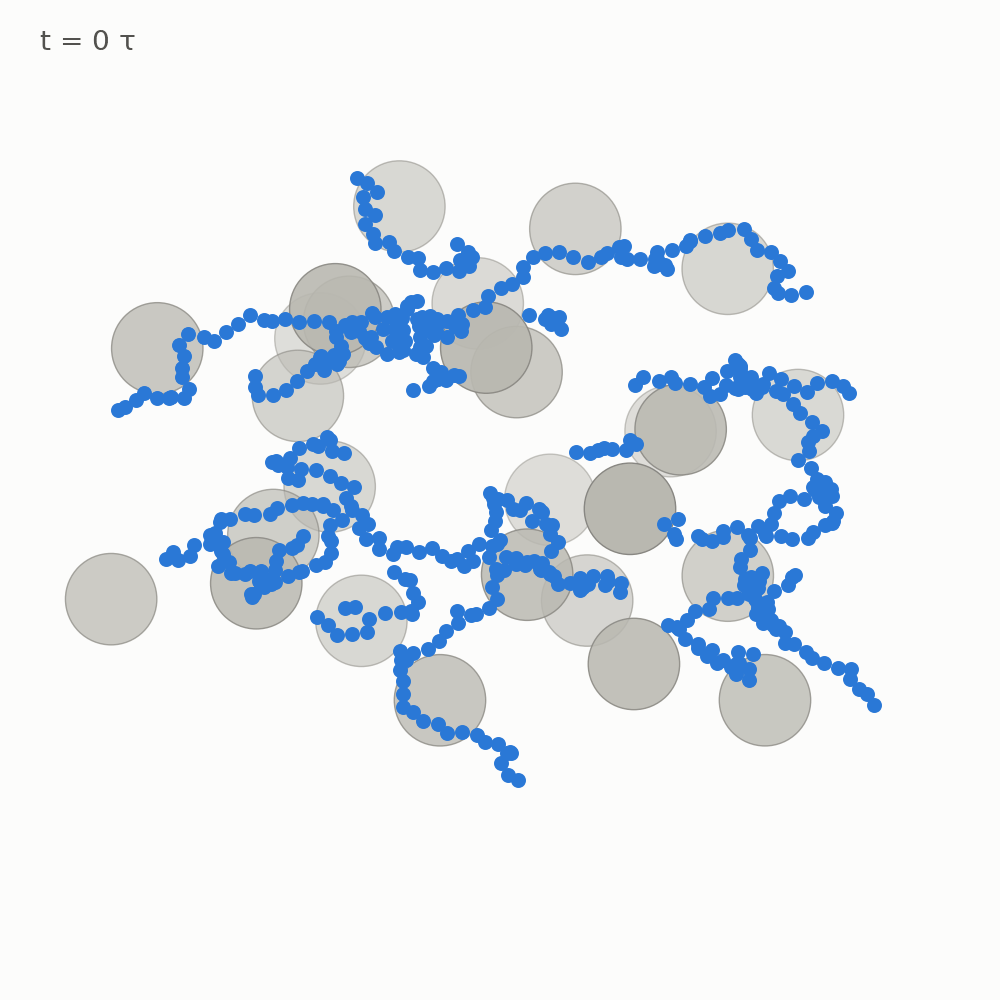
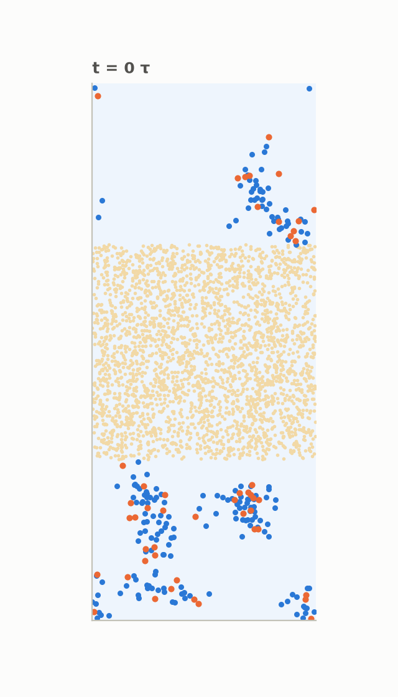
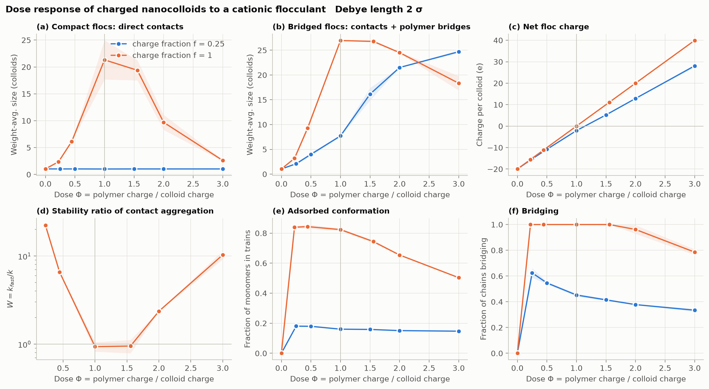
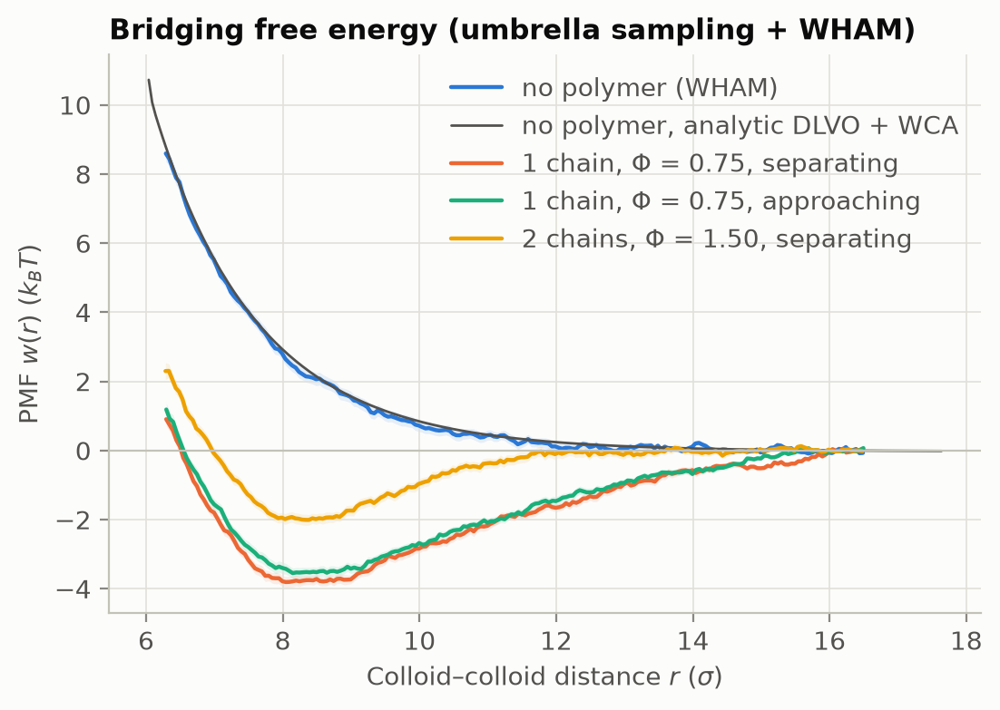
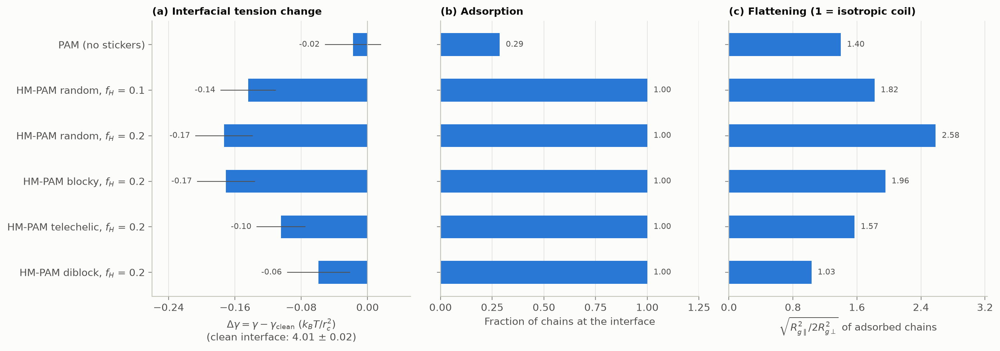
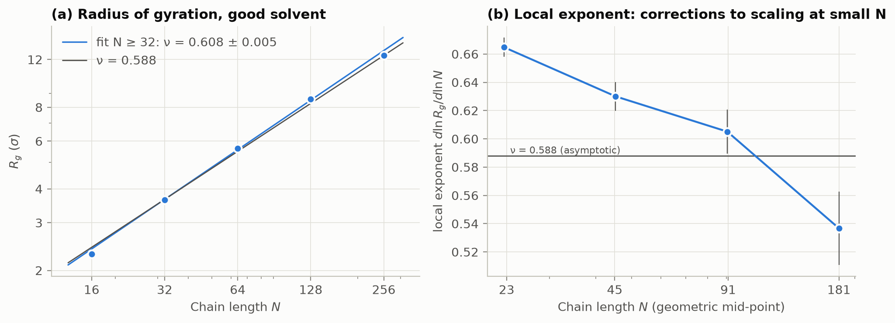
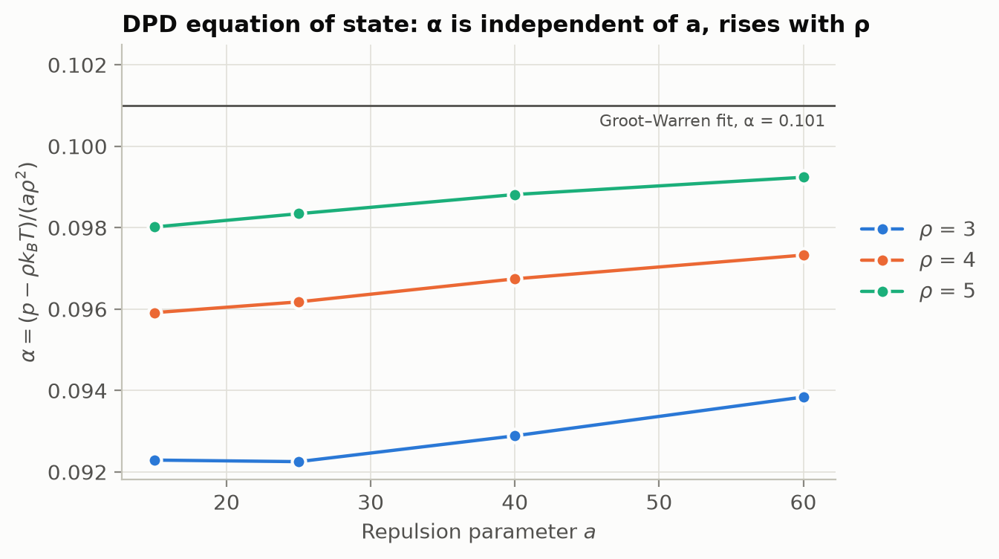

<div align="center">

# flocmd

**Molecular simulation of polymeric flocculants with LAMMPS**

[](https://github.com/carineribeirost/flocmd/actions/workflows/ci.yml)


</div>

flocmd simulates how polymeric flocculants (cationic and hydrophobically
modified polyacrylamides) aggregate charged particles and act at oil/water
interfaces, the two jobs they do in water and produced-water treatment. It
contains four LAMMPS studies and a Python package that builds the systems,
runs parameter sweeps and analyses the output.

<p align="center">
  
  &nbsp;&nbsp;
  
</p>
<p align="center"><sub>
<b>Left:</b> charged nanocolloids (grey) collapse into a single floc at the optimal dose of a cationic flocculant (blue).
<b>Right:</b> HM-PAM chains released in water reach the oil slab (beige) and anchor their hydrophobic stickers (orange) in it.
</sub></p>

## Studies

| | Study | Model |
|---|---|---|
| 1 | Flocculation vs dose and charge density | charged nanocolloids + cationic polyelectrolyte, Langevin dynamics, screened electrostatics |
| 2 | Free energy of a polymer bridge | two colloids, umbrella sampling + WHAM |
| 3 | Flocculants at the oil/water interface | DPD water / oil / PAM / HM-PAM |
| 0 | Validation | Flory exponent, DPD equation of state, DLVO limit |

Models, parameters and the mapping to real units are in [docs/science.md](docs/science.md).

## Results

`quick`-preset runs on an 8-core laptop (Study 2 with `production` windows).
`bash scripts/reproduce_figures.sh` regenerates every figure.

### 1. Charge density decides the flocculation mechanism



* **High charge density (f = 1): charge neutralisation.** Chains adsorb flat.
  Flocs peak where the floc charge crosses zero (Φ ≈ 1), where aggregation is
  diffusion-limited (W ≈ 0.94). Overdosing reverses the charge (+40 e per
  colloid at Φ = 3) and restabilises the dispersion (W ≈ 10).
* **Low charge density (f = 0.25): bridging.** Chains adsorb in loops and
  tails. Colloids never touch, yet up to 62 % of the chains bridge two or more
  colloids and the bridged flocs span almost the whole system.

### 2. A polymer bridge is worth about 4 k<sub>B</sub>T



Without polymer, the PMF matches the analytic DLVO repulsion (RMSD 0.09 k<sub>B</sub>T).
One chain turns the 10 k<sub>B</sub>T barrier into a −3.8 ± 0.2 k<sub>B</sub>T well
(−3.5 ± 0.1 k<sub>B</sub>T when the windows run inwards, so little hysteresis);
two chains (overdosed) give only −2.0 ± 0.2 k<sub>B</sub>T.

### 3. Adsorbing is not the same as lowering the interfacial tension



Plain PAM stays mostly in the water (29 % of the chains reach the interface)
and leaves γ unchanged. Every HM-PAM architecture adsorbs, but distributed
stickers (random, blocky) flatten the chains the most and lower γ the most
(about 4 %). End-anchored stickers (telechelic, diblock) leave the
hydrophilic block dangling in the water and lower γ less (2.5 % and 1.5 %).

These are single short runs: regenerating the figure from the same inputs
moved the clean-interface γ from 3.95 to 4.01 k<sub>B</sub>T/r<sub>c</sub><sup>2</sup>,
three times its error bar, so differences in Δγ below ~0.1 are not resolved.
The ordering of the architectures and the flattening did not change, and the
adsorbed fractions moved by less than 0.1.

### 0. Validation




* **Flory exponent:** ν = 0.608 ± 0.005 for N ≥ 32, approaching 0.588 as the chains get longer.
* **DPD equation of state:** the excess pressure scales as αaρ², with α = 0.092 at
  ρ = 3; the classic α = 0.101 only holds at high density.

## Quick start

```bash
git clone https://github.com/carineribeirost/flocmd && cd flocmd
python -m venv .venv && source .venv/bin/activate   # Linux / WSL2 / macOS
pip install -e ".[dev,lammps]" mpich                 # flocmd + LAMMPS + MPI runtime
pytest                                               # unit + end-to-end LAMMPS tests (~30 s)

flocmd sweep simulations/01_flocculation_kinetics/sweep_dose.toml -j 8 --analyze
flocmd plot flocculation runs/flocculation_dose
```

Other ways to install LAMMPS, single runs and SLURM job arrays: [docs/reproduce.md](docs/reproduce.md).

## Repository layout

```
simulations/   LAMMPS inputs and parameter sweeps (00_validation ... 03_oil_water_interface)
src/flocmd/    builders, analysis, sweeps, plots and the `flocmd` command line
tests/         unit tests + LAMMPS smoke tests
docs/          science.md, reproduce.md, roadmap.md
figures/       figures in this README
```

## Citation

See [CITATION.cff](CITATION.cff), and please also cite LAMMPS:
A. P. Thompson et al., *Comput. Phys. Commun.* **271**, 108171 (2022).
